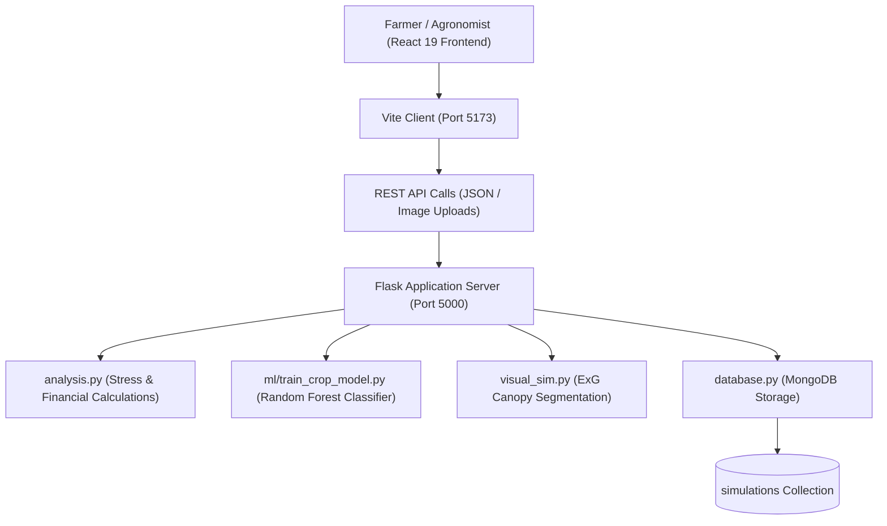

# 🌾 AgriResilience-AI — Climate Risk Simulation & Crop Adaptation

<p align="center">
  
</p>

<p align="center">
  A multimodal full-stack engineering research prototype connecting real-time climate stress scenarios (heat, drought, salinity) to crop risk estimates, trained Random Forest crop suitability predictions, Excess Green Index (ExG) canopy vegetation loss, and financial exposure modeling.
</p>

<p align="center">
  <a href="https://github.com/prakruthidevanga/AgriResilience-AI">
    
  </a>
</p>

<p align="center">
  
  
  
  
  
</p>

---

## 📌 Table of Contents

- [📖 Project Overview](#-project-overview)
- [🎯 Objectives & Scope](#-objectives--scope)
- [✨ Key Workspaces & Capabilities](#-key-workspaces--capabilities)
- [🔬 Mathematical & Machine Learning Foundations](#-mathematical--machine-learning-foundations)
- [🏗️ System Architecture & Data Flow](#️-system-architecture--data-flow)
- [📁 Repository Structure](#-repository-structure)
- [⚙️ Installation and Setup](#️-installation-and-setup)
- [🧪 Running Unit Tests & Verification](#-running-unit-tests--verification)
- [🔮 Current Limitations & Future Work](#-current-limitations--future-work)
- [🤝 Contributing](#-contributing)
- [👩‍💻 Author & Accreditations](#-author--accreditations)

---

## 📖 Project Overview

**AgriResilience-AI** demonstrates a computational pipeline bridging environmental climate anomalies with agricultural vulnerability and biological adaptation concepts. By simulating adverse environmental stressors—such as severe ambient heat waves (up to 50°C), extended dry spells (0–90 days), and elevated soil salinity (0–20 dS/m)—the system produces explainable, bounded risk metrics, estimates financial losses per acre, and classifies optimal crop selection using a trained machine learning model.

### Core Distinctions:
1. **Explainable Rule-Based Risk Engine:** Transparent arithmetic formulations for heat stress, drought stress, salinity stress, and total multi-factor risk scores.
2. **Integrated ML Classifier:** A standalone **Random Forest classifier** trained on multi-attribute agricultural soil and climate datasets to classify crop viability.
3. **Deterministic Canopy Segmentation:** Employs the **Excess Green Index (ExG = $2G - R - B$)** to segment vegetation from background soil in uploaded field images and visualize chlorosis effects proportional to stress severity.
4. **Full-Stack Persistence:** Flask REST API validated by automated unit tests and connected to MongoDB for historical simulation tracking.

---

## 🎯 Objectives & Scope

- 🌾 **Multi-Stress Simulation:** Combine heat, drought, and salinity into a single coherent risk profile across 5 supported crop types (Rice, Wheat, Corn, Soybean, Barley).
- 📊 **Financial Exposure Estimation:** Translate estimated yield losses into monetary exposure per acre ($USD$) to assist in risk planning.
- 🌿 **Canopy Loss Quantification:** Process field imagery to extract real canopy cover ratios rather than using generic mockups.
- 🤖 **Crop Suitability Machine Learning:** Predict the most suitable crop for given soil (N, P, K, pH) and atmospheric conditions.
- 🔬 **Biological Research Framing:** Surface genomic candidates and CRISPR guide concepts for educational and research evaluation.

---

## ✨ Key Workspaces & Capabilities

| Workspace | Module Role | Technical Implementation |
| :--- | :--- | :--- |
| **Overview & History** | Simulation telemetry & logs | Retrieves last 100 simulations from MongoDB (`GET /api/history`) with health diagnostics. |
| **Climate Simulator** | Stress parameter configuration | Interactive sliders for temperature, drought duration, soil salinity, and crop types. |
| **Visual Simulation** | Image-derived vegetation stress | Excess Green Index ($2G - R - B$) canopy segmentation and chlorosis transform. |
| **Crop Suitability AI** | Machine learning recommendation | Standalone scikit-learn Random Forest model trained on multi-parameter agricultural data. |
| **Financial Risk** | Economic impact assessment | Evaluates yield reductions and estimates financial loss exposure per acre. |
| **Genomics & CRISPR** | Conceptual biological adaptation | Explores candidate gene markers and guide concepts for stress-resilient varieties. |

---

## 🔬 Mathematical & Machine Learning Foundations

### 1. Climate Stress Formulas
- **Heat Stress:** Derived from temperature deviations above baseline:
  $$\text{Heat Stress} = \min\left(100, \max\left(0, \frac{T - T_{\text{opt}}}{T_{\text{max}} - T_{\text{opt}}} \times 100 \times M_{\text{crop}}\right)\right)$$
- **Overall Multi-Factor Risk Score:** Weighted composite score:
  $$\text{Risk Score} = 0.30 \times \text{Heat} + 0.40 \times \text{Drought} + 0.30 \times \text{Salinity}$$
- **Yield-Loss & Financial Exposure:**
  $$\text{Yield Loss (\%)} = \text{round}\left((100 - \text{Crop Health}) \times 0.8\right)$$
  $$\text{Financial Impact (\$/acre)} = \text{round}\left(\frac{\text{Yield Loss} \times \$2,200}{100}\right)$$

### 2. Excess Green Index (ExG) Canopy Segmentation
Field images are converted to normalized RGB coordinates to isolate vegetative matter:
$$\text{ExG} = 2G - R - B$$
Pixels with $\text{ExG} > 0$ are classified as canopy foliage, and stress factors deterministically apply yellowing/chlorosis transforms to model drought impact.

---

## 🏗️ System Architecture & Data Flow



---

## 📁 Repository Structure

```text
AgriResilience-AI/
├── backend/
│   ├── app.py                # Flask REST API endpoints and input validation
│   ├── analysis.py           # Core climate stress and financial calculations
│   ├── database.py           # MongoDB connection and simulation history queries
│   ├── ml/
│   │   ├── train_crop_model.py # Random Forest model training pipeline
│   │   └── crop_model.pkl    # Serialized scikit-learn model artifact
│   ├── tests/
│   │   └── test_analysis.py  # Unit test suite for validation and calculations
│   ├── requirements.txt      # Python dependencies
│   └── .env.example          # Sanitized backend environment template
├── frontend/
│   ├── src/
│   │   ├── components/       # Simulation, visualizer, and telemetry components
│   │   ├── services/api.js   # HTTP client communicating with Flask backend
│   │   ├── App.jsx           # Application shell and workspace router
│   │   └── index.css         # Styling rules and responsive design tokens
│   ├── package.json          # Frontend dependencies (React 19, Vite, Chart.js)
│   └── .env.example          # Public frontend environment template
├── VIVA_GUIDE.md             # Oral defense and technical question guide
└── README.md                 # Complete project documentation
```

---

## ⚙️ Installation and Setup

### Prerequisites
- Python 3.10 or higher
- Node.js (v18 or higher)
- MongoDB Community Server running locally on port 27017

---

### Step 1: Start MongoDB
Ensure MongoDB is running locally:
```bash
mongod --dbpath /data/db
```

### Step 2: Set Up Backend (Flask)
```bash
cd backend
python -m venv .venv
.\.venv\Scripts\Activate.ps1
pip install -r requirements.txt
cp .env.example .env

# Train the Random Forest Crop Model
python -m ml.train_crop_model

# Launch the Flask API
python app.py
```
*API runs on `http://localhost:5000`.*

### Step 3: Set Up Frontend (React)
Open a new terminal:
```bash
cd frontend
npm install
npm run dev
```
*Application opens on `http://localhost:5173`.*

---

## 🧪 Running Unit Tests & Verification

The backend calculation engine includes unit tests covering boundary validations, mathematical formulas, and API endpoints:

```bash
cd backend
python -m unittest discover -s tests
```

---

## 🔮 Current Limitations & Future Work

- **Rule-Based Prototype:** Climate-risk scores are illustrative and not calibrated to real micro-climates.
- **Model Scope:** The Random Forest classifier is trained on tabular agronomic indicators and should be validated with localized soil samples.
- **Genomic Projections:** Candidate gene markers and CRISPR guide targets are demonstration concepts for academic research and do not represent validated in-vitro gene edits.
- **Future Integration:** Plans include incorporating satellite multispectral Sentinel-2 imagery and localized meteorological API feeds.

---

## 🤝 Contributing

Contributions, issues, and feature requests are welcome!
1. Fork the Project
2. Create your Feature Branch (`git checkout -b feature/NewCropProfile`)
3. Commit your Changes (`git commit -m 'feat: add sorghum crop profile'`)
4. Push to the Branch (`git push origin feature/NewCropProfile`)
5. Open a Pull Request

---

## 👩‍💻 Author & Accreditations

**Prakruthi B R**  
*BCA Student specializing in Artificial Intelligence & Machine Learning*  
*Alliance University, Bengaluru (CGPA: 9.60)*  
*GeeksforGeeks Campus Mantri (2026)*

- 💻 **GitHub:** [@prakruthidevanga](https://github.com/prakruthidevanga)
- 🔗 **LinkedIn:** [Prakruthi BR](https://linkedin.com/in/prakruthi-br)
- 🌐 **Portfolio:** [prakruthidevanga.github.io](https://prakruthidevanga.github.io/)
- 📬 **Email:** [prakruthibr2006@gmail.com](mailto:prakruthibr2006@gmail.com)

---

<p align="center">
  <b>🌾 Engineering climate resilience through predictive AI and computational biology.</b>
</p>

<p align="center">
  
</p>
